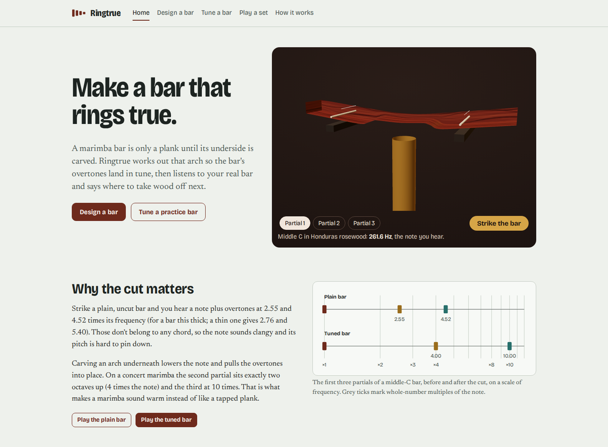
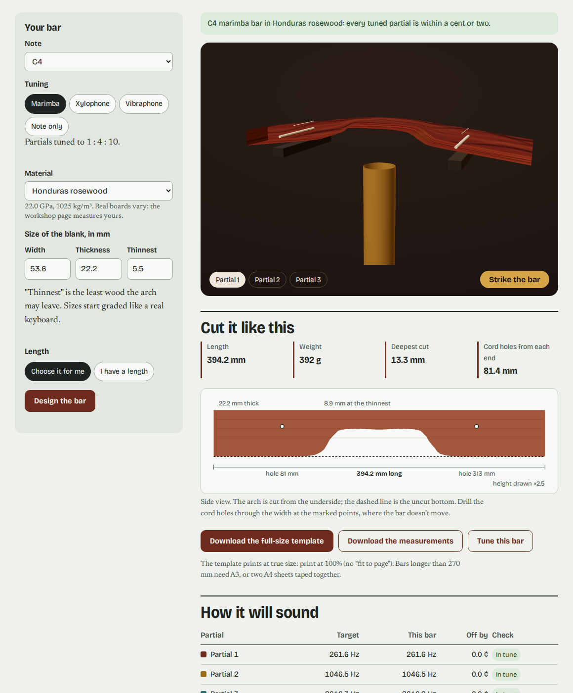
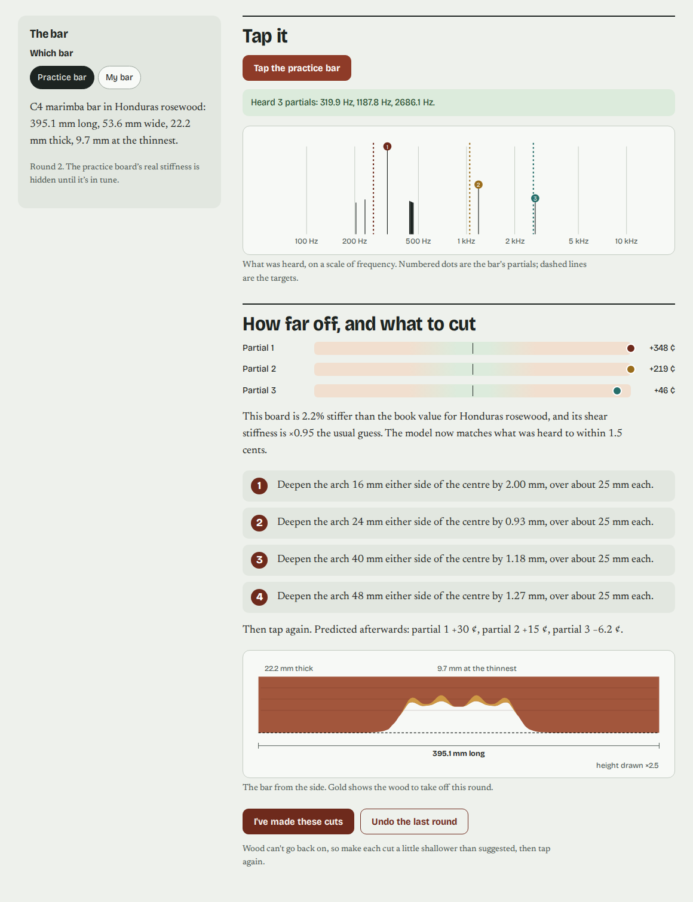
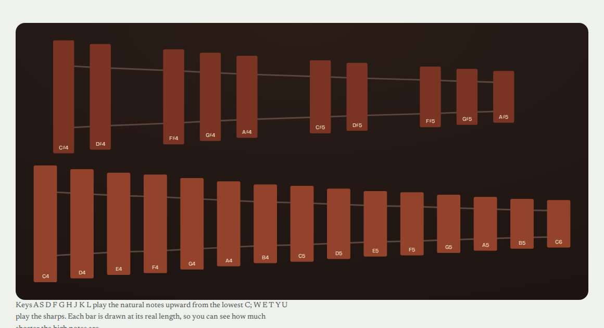
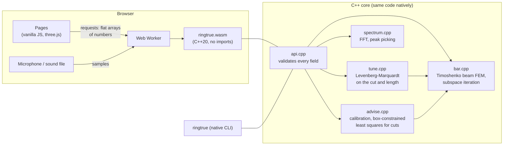

<h1 align="center">Ringtrue</h1>

<p align="center"><b>Designs the arch under a marimba or xylophone bar so its overtones land in tune, then listens to your real bar and tells you where to take wood off next.</b></p>

<p align="center">
  <a href="https://github.com/reihooneh/ringtrue/actions/workflows/ci.yml"></a>
  
  
  
  
</p>

<p align="center"><a href="https://reihooneh.github.io/ringtrue/"><b>Open the live site</b></a> · runs entirely in your browser, nothing to install</p>



## Why I built this

A marimba bar is a plank of hard wood with an arch carved out of its underside. The arch matters: a plain bar's overtones sit at awkward, clashing frequencies. The right arch pulls the second overtone to exactly two octaves above the note and the third to ten times the note, which is what makes a marimba sound warm.

Finding that arch is still mostly trial and error. A maker cuts, taps the bar, reads a tuner, cuts again, and hopes not to go too far, because wood can't be put back. Research groups have shown that a computer model can design the shape. I wanted to see whether one could fit in a web page and also do the second half of the job: hear the real bar, work out how this particular board differs from the textbook, and say exactly where to cut next.

## What it does

- **Design a bar.** Pick a note, a tuning (marimba 1:4:10, xylophone 1:3:6, vibraphone 1:4, or the note only), a wood and the blank's size. You get the length, the arch, where to drill the cord holes, a 3D preview you can strike and hear, and a **full-size printable template**.
- **Tune a real bar.** Tap it near your phone or laptop, or open a recording. Ringtrue finds the partials and **calibrates the model to your board** (its stiffness, and its shear stiffness if two partials were heard). It then plans this round's cuts: up to four, each at most 2 mm deep, checked with full solves before you see them. A **practice bar** with hidden wood properties lets anyone try the whole loop.
- **Play a set.** Two octaves of designed bars, drawn to scale and playable from the mouse or keyboard. Change the wood and the set is redesigned in the browser.
- **How it works**, including a table computed live in your browser that checks the core against exact beam theory.

| Designer | Workshop |
|---|---|
|  |  |



## How it works



- **The bar** is a Timoshenko beam (bending, shear and rotary inertia), because real marimba bars are too thick for the simple theory: a plain middle-C blank's overtones sit at 2.55 and 4.52 times the note, not the textbook 2.76 and 5.40.
- **The partials** come from 300 finite elements and banded matrices, with subspace iteration and a Rayleigh–Ritz step.
- **The arch** is four depths joined by a monotone cubic (it can never undercut the minimum thickness), plus its reach and the bar's length. These are fitted by Levenberg–Marquardt from several starting shapes, with the note given priority when not everything fits.
- **Hearing** uses an FFT with a falling half-Hann window (wooden bars' upper partials die in hundredths of a second) and parabolic peak refinement.
- **Cutting advice** linearises cents per millimetre at 24 places plus "trim the ends", then solves a least-squares problem in which amounts can only be positive.

The full walkthrough is in [HOW-IT-WORKS.md](HOW-IT-WORKS.md).

### The same core on the command line

```
$ ./build/ringtrue design --note C4
RINGTRUE  C4 bar in Honduras rosewood  (three-partial tuning 1 : 4 : 10)

Bar     395.1 mm long, 53.6 mm wide, 22.2 mm thick, 394 g
Cut     arch from the underside, 191.9 mm long, deepest 13.3 mm (leaves 8.9 mm)

Partial   Target Hz   Bar Hz      Cents off
  1         261.63      261.63     +0.00 ok
  2        1046.50     1046.50     -0.01 ok
  3        2616.26     2616.23     -0.02 ok

Support holes (nodes of the first partial): 81.8 mm and 313.3 mm from the left end
```

## Stack

| Part | Choice | Why |
|---|---|---|
| Numerical core | C++20, no standard library, no heap | One codebase for the browser and the CLI. Static buffers can't leak or overflow unseen, and the sanitizers check them |
| Browser build | clang → `wasm32`, about 68 KB, **imports nothing** | The module can only compute: it can't touch the page, storage or the network |
| Front end | Vanilla JavaScript modules, a Web Worker, Web Audio, an AudioWorklet | No framework needed; designs run off the main thread |
| 3D | three.js 0.170, self-hosted | The bar bends in its real mode shapes, with a flat SVG fallback |
| Tests | A C++ test harness under ASan and UBSan, `node:test`, Playwright | Over 9,000 core checks, plus Node and browser tests at three screen sizes |
| CI and hosting | GitHub Actions → GitHub Pages | Every push runs lint, tests and audit before deploying |

## Run it yourself

You need clang with the WebAssembly target and `wasm-ld` (Ubuntu: `apt install clang lld`), g++, and Node 22.

```bash
npm ci
make wasm cli            # build/ringtrue and site/assets/ringtrue.wasm
npm run build            # pages, data from the core, vendored three.js and fonts
npm run serve            # http://127.0.0.1:4173/
./build/ringtrue design --note A3 --wood jarrah --tuning xylophone
```

## Tests

```bash
make test-core           # C++ core under AddressSanitizer + UBSan
make lint                # clang-tidy, warnings are errors
npx playwright install chromium
npm test                 # WebAssembly in Node, then every page in a real browser
```

- **Core (9,000+ checks):**
  - The maths library against libm, and the FFT against a direct DFT.
  - Free–free beam frequencies and node positions against exact theory, plus mesh convergence and scaling laws.
  - Designs for marimba, xylophone and fixed-length bars, including determinism and honest reporting when targets can't be met.
  - Hearing synthetic taps, including fast-dying partials, silence, noise and NaN.
  - A **full simulated tap-and-cut loop**: a bar 256 cents sharp, in wood 7% stiffer than the book, is in tune to within a cent by the fourth tap.
  - Every request field refusing bad values, plus 400 random requests.
- **Node:**
  - The WebAssembly module has no imports.
  - It gives the same bars as the native CLI.
  - The page applies cuts the same way the core does.
  - Crafted links are ignored.
- **Browser:**
  - Every page at desktop, tablet and phone widths: no errors, no sideways scrolling, no overlapping text in HTML or SVG.
  - CSP and no inline code.
  - The 3D stage and its WebGL-off fallback.
  - The designer and its downloads.
  - The practice bar tuned to completion.
  - Junk recordings, bad measurements, the playable set, and the live beam-theory check.

## Security

Ringtrue has no server, accounts or storage, and sends no analytics. The main risks are hostile input (links, forms, sound files) and the page itself. In short:

- **Strict Content-Security-Policy:**
  - `default-src 'none'`.
  - Scripts from the site only, plus `'wasm-unsafe-eval'` to compile the module.
  - No inline scripts, styles or event handlers, which a test enforces.
  - Everything is self-hosted, so no third-party requests.
- **Validated twice.** The page checks forms and links, and the C++ core checks every field again (finite, in range, whole numbers where needed) before any maths runs. 400 random requests and a table of bad values are tested under the sanitizers.
- **No HTML from strings.** The DOM is built with `textContent` and `createElement`, and a test fails the build if `innerHTML`, `eval` or `new Function` appear.
- **Recordings stay on the device.** They are analysed in a worker and then dropped. Microphone access is requested only when you press "Listen". Files are capped at 20 MB and 20 seconds.
- **Least privilege in CI:**
  - Read-only token by default.
  - Pages write access only in the deploy job.
  - Dependencies pinned and audited.

See [SECURITY.md](SECURITY.md) for the threat model and how to report a problem. No software is perfectly secure; this one aims to have little worth attacking and few ways in.

**Known limits:**
- The model covers bending only, not twisting or sideways modes.
- It treats the wood as uniform.
- Temperature and humidity shift the pitch.
- Material values are typical book figures; the workshop calibrates them to your board.

## Roadmap

- Twisting and sideways modes (a plate or 3D model) to warn when they land near a tuned partial.
- Resonator tube design with a proper end correction and temperature.
- A "measure the underside" helper using a phone photo of the bar against a ruler.
- Sharing a whole instrument's plan as a single printable booklet.

## Licence

MIT. Wood data: The Wood Database, WoodSolutions. Fonts: Bricolage Grotesque and Newsreader (SIL Open Font Licence). 3D: three.js (MIT).
